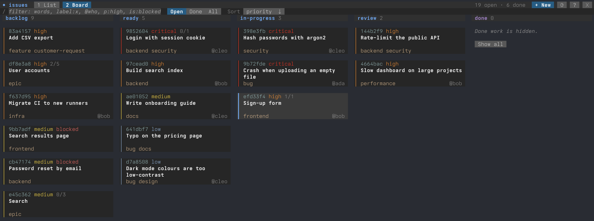
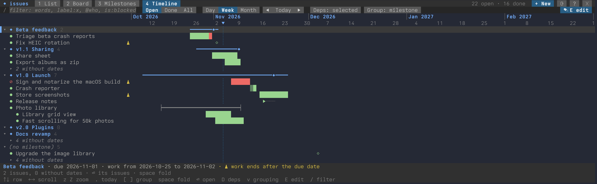
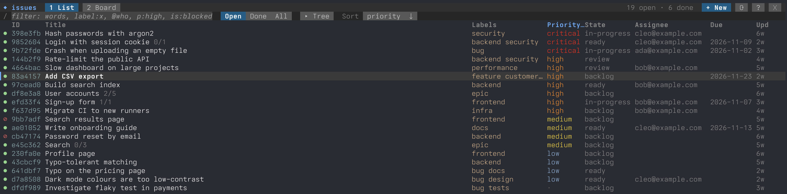

# git-native-issuez

Issue tracking stored in git, as a Zig library and a drop-in `git-issue`
command. It reads and writes the format of
[git-native-issue](https://github.com/remenoscodes/git-native-issue) (format
1), so issues written by either tool work with the other.

- **No server, no database:** issues are commit chains under
  `refs/issues/<uuid>`, shared through any git remote.
- **More than format 1:** parent issues, blockers, dates, estimates,
  workflow states, milestones and image attachments, as extra trailers that
  upstream keeps and shows.
- **A terminal UI:** a list, a kanban board, milestones and an editable
  timeline, usable with the mouse, updating live when anyone else writes.
- **For coding agents:** `git issue mcp`, a Model Context Protocol server.
- **For scripts:** `--json` on every read command, man pages and shell
  completions.







> [!WARNING]
> Generative AI was used to edit and/or produce large portions of this code.
> Every line in this repo was verified by a human.

## Install

```sh
# Linux and macOS
curl -fsSL https://raw.githubusercontent.com/EuroZig/git-native-issuez/main/install.sh | sh

# Homebrew (macOS 13 or later, Linux)
brew tap eurozig/tap
brew trust eurozig/tap
brew install git-native-issuez
```

Windows archives, the CLI-only flavor, the installer's options and building
from source: [Installing in detail](#installing-in-detail).

## Quick start

```sh
git issue create "Login page crashes" -l bug -p high
git issue ls
git issue comment a7f3 -m "Happens on Safari only."
git issue edit a7f3 -a ada@example.com --estimate 2h
git issue close a7f3 --fixed-by 1a2b3c4
git issue sync origin            # merge the remote's issues, push ours
git issue                        # at a terminal: the terminal UI
```

Issue IDs can be shortened to any unique prefix.
`git issue <command> --help` (or `man git-issue-<command>`) describes each
command.

## Features

### Planning and milestones

```sh
git issue edit a7f3 --parent 5e21 --due 2026-12-01
git issue tree                         # parents, sub-issues, progress, blockers
git issue milestone create v1.0 --due 2026-12-01
git issue edit 5e21 --milestone v1.0   # sub-issues inherit it
git issue milestone show v1.0          # its issues and progress
```

- An issue is in a milestone directly or through its parent; a milestone
  completes once all of its issues are closed.
- Milestones live under `refs/milestones/<uuid>` and sync with the issues.
  Linking one also writes upstream's `Milestone:` field.

### History is never rewritten

- Editing, deleting and restoring comments (`comment --edit`, `--delete`,
  `--restore`) and issues (`delete`, `restore`) each add a commit.
- `git issue show --ids` shows comment IDs; `git issue ls --problems` lists
  issues whose parent or blocker is missing or loops back.

### Sync

- `git issue sync <remote>` fetches, merges and pushes issues and
  milestones. Concurrent edits get a merge commit, and
  `git issue ls --conflicts` shows where clones disagreed.
- It never force-pushes or drops a version: an issue whose remote history
  was rewritten is quarantined until you decide (`git issue status`,
  `git issue quarantine`).
- Clones can also sync with upstream's `git issue merge` and `git push`.

### Attachments

```sh
git issue comment a7f3 -m "Cut off on small screens." --attach login.png
git issue attach cat a7f3 fc7b > login.png
```

PNG, JPEG or WebP images, stored as git-lfs objects that `git issue sync`
uploads and downloads. Without git-lfs only the attachment commands refuse.
See [docs/attachments.md](docs/attachments.md).

### Terminal UI

`git issue tui`, or plain `git issue` at a terminal: a list (optionally a
tree of sub-issues), a kanban board by workflow state and a detail view
where every field is edited in place. `?` shows the keys; the mouse works
everywhere. The list is sortable and filterable
(`label:ui @ada p:high is:blocked -label:wontfix`). It updates live when
the CLI, another TUI or an agent writes.

Milestones (`3`) shows every milestone with its progress, due date and
health, sorted and filtered as you like; `n` creates one. Enter opens its
issues, where `m`, `[` `]`, marks and a second pane (`v`) move work
between milestones, and `n` or `N` adds work to it. The timeline (`4`)
draws milestones, issues and blockers over the days. In its edit mode
(`E`) bars move and stretch with the keys or the mouse, nothing is written
until `ctrl+s` applies every change at once, and the view can't be left
with changes neither applied nor discarded. Schedules count working days
when `git config issue.workDays "mon,tue,wed,thu,fri"` says which they
are, and an estimate's day is `git config issue.hoursPerDay` hours
(default 8).

The `⇅` badge in the top bar says what isn't pushed (`↑`), what the
remote's history was refused for (`!`) and what is left in conflict
(`✕`). `y` syncs (fetch, merge, push, as `git issue sync`) in the
background; `Y` opens the sync panel, where quarantines are resolved and
conflicts opened. `git config issue.remote` picks the remote, and `git
config issue.autoSync 10` fetches and merges every 10 minutes (it never
pushes on its own). git never prompts: it runs without a terminal, ssh in
batch mode unless you set your own ssh command, so a key needs an agent.

### Coding agents (MCP)

`git issue mcp` serves the issues over the
[Model Context Protocol](https://modelcontextprotocol.io) on stdio: tools to
list, show, search, create, comment on, edit and close issues, and resources
that notify subscribers of changes. For Claude Code, run
`git issue mcp install` once; [docs/mcp.md](docs/mcp.md) has the tools and
other clients.

### Scripts and other tools

- `--json` on `ls`, `show`, `tree`, `search`, `status`, `attach ls`,
  `milestone ls` and `milestone show`; fields are only ever added
  ([docs/json.md](docs/json.md)).
- The `git-issue-<command>` entry points are installed like upstream's, so
  scripts calling them keep working.
- [lazygit](https://github.com/jesseduffield/lazygit): an issues menu under
  one key ([docs/lazygit.md](docs/lazygit.md)).

### Importing from GitHub, GitLab and others

Import, export and sync with GitHub, GitLab and Gitea/Forgejo, and import
from Azure DevOps, come from upstream: install
[git-native-issue](https://github.com/remenoscodes/git-native-issue) next to
this one and run its `git-issue-import`, `git-issue-export` and
`git-issue-sync` in the same repository. Both share the issue refs, so
imported issues work here as they are. Install upstream first: both install
`git-issue` and its `git-issue-<command>` entry points, so upstream
installed after this one into the same prefix overwrites ours (run
`update-git-native-issuez` again to fix it). Upstream's
[Platform Bridges](https://github.com/remenoscodes/git-native-issue#platform-bridges)
cover providers, tokens and options.

## Using the library

Add the package with `zig fetch --save <url>` and import the `issuez`
module:

```zig
// build.zig
const issuez_dep = b.dependency("git_native_issuez", .{ .target = target, .optimize = optimize });
exe.root_module.addImport("issuez", issuez_dep.module("issuez"));
```

```zig
const issuez = @import("issuez");
const Repo = issuez.Repo(issuez.backend.GitProcess);

var git = try issuez.backend.GitProcess.open(io, gpa, .{ .path = ".", .environ_map = env });
defer git.close();
const repo = Repo.init(&git);
const created = try repo.create(arena, .{ .title = "Login page crashes", .labels = &.{"bug"} });
const open = try issuez.query.list(arena, try repo.loadAll(arena), .{ .state = .open }, .{});
for (open) |issue| std.debug.print("{s} {s}\n", .{ issue.state.text(), issue.title });
```

- `Repo` is generic over its backend: `GitProcess` drives the `git` binary,
  `GitSim` is an in-memory repository for tests, or bring your own
  ([docs/design.md](docs/design.md)).
- As a dependency the package builds only the library: libvaxis, blitzmcp
  and nightwatch are never fetched. Pass `.tui = true` or `.mcp = true` to
  build them into `git-issue`.

| Example                                           | Shows                                                                                  | Run                                        |
| ------------------------------------------------- | -------------------------------------------------------------------------------------- | ------------------------------------------ |
| [quickstart.zig](examples/quickstart.zig)         | create, resolve by prefix, comment, edit, close, list, show (in memory, no git needed) | `zig build example-quickstart`             |
| [sync.zig](examples/sync.zig)                     | two clones syncing through a remote, with a concurrent edit (in memory)                | `zig build example-sync`                   |
| [attachments.zig](examples/attachments.zig)       | validate, attach with a comment, read bytes back, rename and remove (in memory)        | `zig build example-attachments`            |
| [real_repo.zig](examples/real_repo.zig)           | the same API on a real repository through `GitProcess`                                 | `zig build example-real-repo -- <repo> ls` |
| [custom_backend.zig](examples/custom_backend.zig) | your own backend (audit log, write policy) and ETag-style `.expect` versions           | `zig build example-custom-backend`         |

## Docs

- [docs/format.md](docs/format.md): the format on disk.
- [docs/attachments.md](docs/attachments.md): attachments in the CLI and the
  library.
- [docs/json.md](docs/json.md): the `--json` output.
- [docs/lazygit.md](docs/lazygit.md): an issues menu for lazygit.
- [docs/mcp.md](docs/mcp.md): the MCP server for coding agents.
- [docs/design.md](docs/design.md): how the library is put together.
- [docs/compatibility.md](docs/compatibility.md): where the CLI differs from
  upstream on purpose.
- [CHANGELOG.md](CHANGELOG.md): what changed.

## Installing in detail

### Flavors and archives

Each [release](https://github.com/EuroZig/git-native-issuez/releases) has
two flavors, for Linux and macOS (x86_64, aarch64) and Windows (x86_64):

- `full`, the default: with the terminal UI and the MCP server;
- `minimal`: the CLI only.

The Linux and macOS archives also have the shell completions, man pages and
docs under `share/`. The Windows archive has `git-issue.exe` only: run
`git issue <command>` there. `SHA256SUMS` lists the checksums. To install
one by hand, unpack it into a prefix with `bin/` on your `PATH`:

```sh
gh release download v0.3.0 --repo EuroZig/git-native-issuez --pattern '*-full-aarch64-macos.tar.gz'
tar -xzf git-native-issuez-0.3.0-full-aarch64-macos.tar.gz --strip-components=1 -C ~/.local
```

On macOS, an archive downloaded with a browser is quarantined and
`git-issue` won't run: download it with `gh` or `curl -LO`, or run
`xattr -d com.apple.quarantine <archive>` before unpacking.

### install.sh

It downloads the latest release for your machine, checks it against
`SHA256SUMS` and unpacks it into `~/.local`.

- Options go after `sh -s --`: `--flavor minimal`, `--version 0.3.0`,
  `--prefix /usr/local`. For a prefix you can't write to, pipe it into
  `sudo sh -s -- --prefix /usr/local`.
- It doesn't touch your shell configuration: if `~/.local/bin` isn't on
  `PATH`, it says so.
- To read it first, download it and run `sh install.sh`.
- `update-git-native-issuez`, installed next to `git-issue`, updates with
  the same flavor and prefix; extra arguments (`--version`, `--no-verify`)
  go to `install.sh`.
- `--no-verify` skips the checksum check, for that run only.
- `update-git-native-issuez --uninstall` (or
  `install.sh --uninstall --prefix <dir>`) removes everything it installed,
  and nothing else. The issues in your repositories stay.

### Homebrew

The [EuroZig tap](https://github.com/EuroZig/homebrew-tap) installs the full
flavor with the man pages and the bash, zsh and fish completions. Homebrew
only loads formulae from taps outside its own once you trust them, so
`brew trust eurozig/tap` is needed once; after that, `brew upgrade` keeps
git-native-issuez up to date with your other packages. A Homebrew without
`brew trust` doesn't need that line.

### From source

With Zig 0.16.0 and git 2.30 or newer:

```sh
zig build -Doptimize=ReleaseSafe --prefix ~/.local   # add -Dminimal for the CLI only
```

## Development

```sh
zig build                      # git-issue with the TUI and the MCP server, links, completions, man pages
zig build link                 # also symlink it into ~/.local (-Dlink-prefix=<dir>); unlink removes them
zig build -Dminimal            # without the TUI and the MCP server (or -Dtui=false / -Dmcp=false)
zig build test                 # unit, backend, CLI, simulator and fuzz smoke tests, examples
zig build test-interop         # both tools on shared repositories (fetches upstream)
zig build e2e                  # the MCP server with the official SDK client (Node.js, npm),
                               # and two TUIs on pseudo-terminals following each other's writes
zig build test-tui-e2e         # only the TUIs' (Linux, macOS)
zig build test-upstream-suite  # upstream's t/*.sh against our git-issue
zig build test-perf            # `ls -a` over 10 000 issues within 2 s
zig build ci -Dseed=N          # all of the above, plus long fuzz runs: what CI runs
zig build update-snapshots     # rewrite examples/*.out after an intended output change
zig build release              # the release archives for every platform, in zig-out/release/
```

- Every command also runs in a simulator on an in-memory repository, where
  an independent oracle checks what it may change, and a fuzzer runs random
  commands through both ([docs/design.md](docs/design.md)).
- The in-memory examples must print exactly their snapshot
  (`examples/<name>.out`).
- Upstream is only fetched for `test-interop` and `test-upstream-suite`, and
  never vendored.
- [CONTRIBUTING.md](CONTRIBUTING.md) has the rules for changes.

## License

MIT, see [LICENSE](LICENSE). Upstream git-native-issue is GPL-2.0 and no
part of it is included here.
